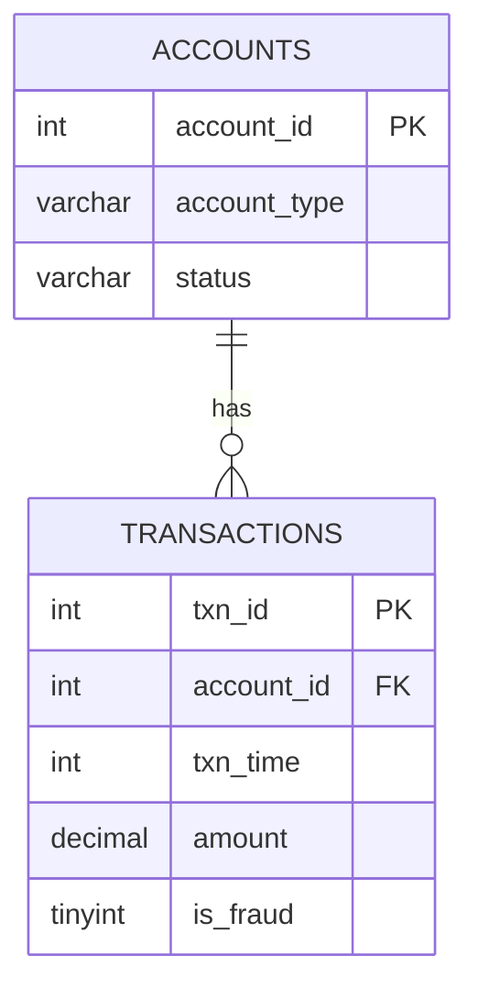

# Bank Transaction Fraud Risk Analysis | MySQL

A SQL-based fraud detection project built on the [ULB Credit Card Fraud Detection dataset](https://www.kaggle.com/mlg-ulb/creditcardfraud) (284,807 real anonymized transactions, 492 labeled fraud cases). The project models transactions into a relational schema and uses window functions, CTEs, and statistical heuristics to detect and validate fraud patterns in SQL.

## Overview

- **284,807** real transactions loaded and modeled across **5,000** synthetic accounts
- Custom fraud-detection heuristics built entirely in SQL (no ML libraries)
- Heuristics validated against real ground-truth fraud labels for precision
- Two heuristic versions (v1 → v2) showing iterative improvement

## ER Diagram



## Schema

```sql
CREATE TABLE accounts (
    account_id   INT PRIMARY KEY AUTO_INCREMENT,
    account_type VARCHAR(20) DEFAULT 'Card',
    status       VARCHAR(20) DEFAULT 'Active'
);

CREATE TABLE transactions (
    txn_id      INT PRIMARY KEY AUTO_INCREMENT,
    account_id  INT,
    txn_time    INT,
    amount      DECIMAL(12,2),
    is_fraud    TINYINT,
    FOREIGN KEY (account_id) REFERENCES accounts(account_id)
);
```

## Analysis performed

1. **Top-risk account ranking** — `RANK()` window function over accounts grouped by fraud transaction count
2. **Rolling average spending** — 5-transaction moving average per account using `AVG() OVER (... ROWS BETWEEN 4 PRECEDING AND CURRENT ROW)`
3. **v1 Heuristic — fixed threshold**: flag transactions > 5x an account's average amount
4. **v2 Heuristic — statistical + velocity**: flag transactions > 3 standard deviations above account mean, combined with 2+ transactions within a 1-hour window
5. **Precision validation** — each heuristic checked against the dataset's real `is_fraud` labels

## Results

| Heuristic | Logic | Total Flagged | True Positives | Precision | Recall (of 492 fraud cases) |
|---|---|---|---|---|---|
| v1 | Amount > 5x account average | 11,776 | 40 | 0.34% | 8.1% |
| v2 | 3σ outlier + 2+ transactions/hour | 5,984 | 14 | 0.23% | 2.8% |

**Key finding:** v1's fixed-threshold rule over-flags legitimate large purchases, producing very low precision. v2 attempted to improve on this by combining a statistical outlier measure (3 standard deviations above account mean) with a transaction-velocity signal (2+ transactions within an hour) — a heuristic closer to real fraud-detection systems. Counterintuitively, v2 performed *worse* on both precision and recall: the velocity filter excluded genuine fraud cases rather than isolating them, revealing that fraud in this dataset predominantly occurs as **isolated, single transactions** rather than rapid bursts. This suggests that further gains would require richer per-transaction features (e.g. merchant category, geographic distance, time-of-day) rather than simple frequency counts — and is a realistic illustration of why production fraud systems move beyond rule-based heuristics to ML models.

## Tech used

- MySQL 8.0 (MySQL Workbench)
- Window functions: `RANK()`, `AVG() OVER()`, `COUNT() OVER()`
- CTEs (`WITH` clauses)
- Multi-table joins, aggregate functions, `STDDEV()`

## Files

- `schema.sql` — table definitions
- `queries.sql` — all analytical queries (ranking, rolling average, v1/v2 heuristics, precision validation)

## Dataset source

[Credit Card Fraud Detection — Kaggle (ULB)](https://www.kaggle.com/mlg-ulb/creditcardfraud)
